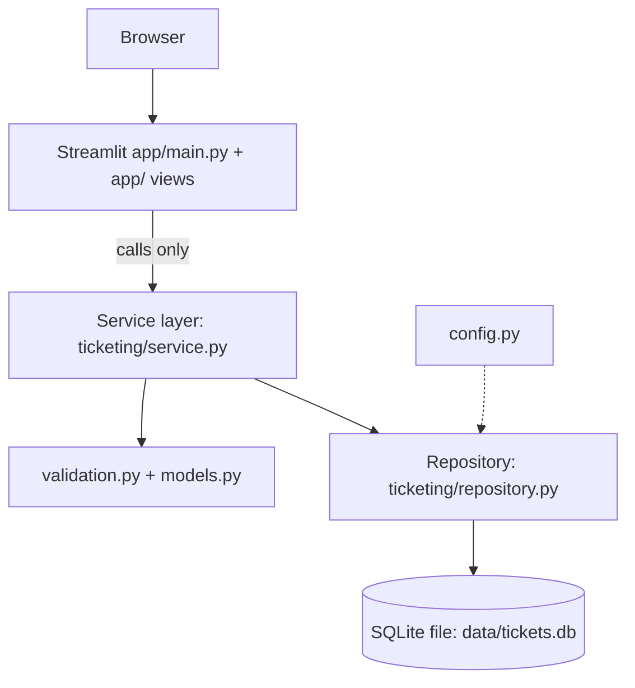

# Architecture: IT Support Ticket Management System (Local Classroom MVP)

Status: APPROVED by the human and reconciled with the as-built code (see section 14, As-built deviations). Owner: solution-architect.
Requirements authority: `docs/requirements.md` (now includes category FR-001/FR-020, resolution note FR-021/AC-030, four-status dashboard FR-013/FR-014, DEMO label FR-022/AC-031). The former [REQ-DELTA] markers are resolved against those IDs below. Requirements A-16 (resolution-note rule) and A-18 (category list) are still worded as OPEN in `docs/requirements.md`; this design implements the approved decisions D-04 and D-01, and the requirements-analyst should close them.

## 0. Simplicity statement
Deliberately simple: one process, one SQLite file, three layers (UI -> service -> repository). No ORM, no auth framework, no async, no web API, no caching layer, no plugin or DI framework. Plain functions and frozen dataclasses. Streamlit is a thin view layer.

## 1. DEMO role selector disclosure (mandatory)
The role selector is a **DEMO convenience, NOT authentication and NOT authorization**. Any user can pick any role and read or alter any ticket. No access-control guarantee is made. This must appear (a) in README/docs, (b) as a persistent banner on every page of the UI (text in section 6.2), and (c) in this document. Traces: FR-018, FR-022, NFR-009, AC-023, AC-031.

Deployment constraint: because the selector is neither authentication nor authorization, the app **must not be publicly deployed (internet, shared network or cloud) as a secure multi-user application** and must not hold confidential data. It is for single-user local classroom use only; the server is bound to `127.0.0.1` via `.streamlit/config.toml` (NFR-010). Any multi-user use requires real authentication, authorization and a re-review first (security review F-01).

## 2. System architecture



Layer rules:
- UI imports only `ticketing.service`, `ticketing.models` (DTOs and enums) and `ticketing.exceptions`. It must not import `sqlite3`, `repository`, or `db`, and contains no SQL (NFR-007, AC-027).
- Service: validation, transition rules, dashboard aggregation, orchestration. Raises typed exceptions. Never returns raw rows or sqlite objects.
- Repository: all SQL, parameterized only (`?` placeholders; never f-strings or concatenation, including for filters, which use fixed SQL fragments chosen from a whitelist). Returns DTOs.
- Each repository call opens a short-lived connection (`with closing(connect(db_path))`, commit/rollback via `with conn:`). This avoids Streamlit rerun and thread issues with a shared connection.

Runtime/config:
- Python 3.10+. Start: `python -m streamlit run app/main.py` from repo root. Local only, bound to `127.0.0.1` (default port 8501) by `.streamlit/config.toml`, which also disables usage stats (NFR-010). No outbound network calls. `app/main.py` bootstraps `sys.path` so `ticketing` and `app` import from the repo root.
- DB path: `ticketing/config.py` resolves `TICKETS_DB_PATH` env var, defaulting to `<repo_root>/data/tickets.db`. Parent dir is created if missing. Tests pass an explicit path (tmp file); services take `db_path` as a parameter, so no global state. The `data/` directory and `*.db` are git-ignored (no data in repo). No secrets exist or are needed.
- Init: `init_db(db_path)` runs `CREATE TABLE IF NOT EXISTS` and sets `PRAGMA user_version = 1`. Called once at app start (guarded by `st.cache_resource`) and by test fixtures.
- Migration approach (MVP): `user_version` check; if version is greater than the code's known version, raise `DatabaseError`. Future changes add numbered `ALTER` steps keyed on `user_version`. No migration tool.

## 3. Module layout and responsibilities

```
app/
  __init__.py
  main.py                   # frontend: entry point, DEMO banner call, role selector, routing
  common.py                 # frontend: DB path/init (cached), DEMO banner, flash, error-safe call(), ticket table
  views_employee.py         # frontend: create ticket form + "my tickets"
  views_list.py             # frontend: shared filter controls (incl. search) and all-tickets list
  views_engineer.py         # frontend: list/filter, detail, status/priority/note updates
  views_manager.py          # frontend: dashboard
.streamlit/
  config.toml               # human/orchestrator-approved: server.address 127.0.0.1, usage stats off
ticketing/
  __init__.py
  config.py                 # backend: DB path resolution, constants (lengths)
  exceptions.py             # backend
  models.py                 # backend: enums, Ticket, TicketFilter, DashboardStats
  validation.py             # backend: pure functions, no I/O
  db.py                     # backend: connect(), init_db(), schema DDL string
  repository.py             # backend: SQL, parameterized
  service.py                # backend: public contract used by UI
tests/                      # qa-engineer
  conftest.py, test_service_create.py, test_service_query.py, test_service_update.py,
  test_dashboard.py, test_persistence_security.py, test_safety.py,
  test_ui_smoke.py, test_architecture.py
reports/                    # qa/security: pytest-output.txt, ruff-output.txt, test-report.md, security-review.md
pyproject.toml              # qa-engineer: pytest + ruff config (see section 8)
requirements.txt            # backend-developer (pinned deps; install needs human approval)
README.md                   # backend-developer drafts run instructions; DEMO disclosure text is shared copy from section 1
data/                       # runtime, git-ignored
```

## 4. SQLite schema

```sql
-- user_version = 1
CREATE TABLE IF NOT EXISTS tickets (
    id              INTEGER PRIMARY KEY AUTOINCREMENT,   -- unique, never reused
    title           TEXT    NOT NULL CHECK (length(trim(title)) BETWEEN 1 AND 100),
    description     TEXT    NOT NULL CHECK (length(trim(description)) BETWEEN 1 AND 2000),
    category        TEXT    NOT NULL CHECK (category IN ('Hardware','Software','Network','Access','Other')),
    priority        TEXT    NOT NULL CHECK (priority IN ('Low','Medium','High','Critical')),
    status          TEXT    NOT NULL DEFAULT 'Open'
                            CHECK (status IN ('Open','In Progress','Resolved','Closed')),
    creator         TEXT    NOT NULL CHECK (length(trim(creator)) BETWEEN 1 AND 100),
    created_at      TEXT    NOT NULL,   -- UTC ISO-8601 'YYYY-MM-DDTHH:MM:SSZ'
    updated_at      TEXT    NOT NULL,   -- same format; set on every change
    resolution_note TEXT    NULL CHECK (resolution_note IS NULL OR length(trim(resolution_note)) BETWEEN 1 AND 2000),
    CHECK (updated_at >= created_at),
    CHECK (status NOT IN ('Resolved','Closed') OR resolution_note IS NOT NULL)  -- see D-04
);
CREATE INDEX IF NOT EXISTS idx_tickets_creator_nocase ON tickets (creator COLLATE NOCASE);
CREATE INDEX IF NOT EXISTS idx_tickets_status   ON tickets (status);
CREATE INDEX IF NOT EXISTS idx_tickets_priority ON tickets (priority);
CREATE INDEX IF NOT EXISTS idx_tickets_category ON tickets (category);
```

Notes:
- Timestamps: TEXT, UTC, fixed-width ISO-8601 with `Z`, generated in Python by one helper (`now_utc_iso()`), so they sort lexicographically. UI displays them as-is with " UTC" (A-14). No local-time conversion in MVP.
- The data layer enforces enums via CHECK (NFR-004); the service validates first to give friendly messages. CHECK failures (sqlite3.IntegrityError) map to `DatabaseError`, never shown raw.
- Ticket ID is assigned by SQLite (AUTOINCREMENT); display as `#<id>`.
- Priority/status/category lists are defined once in `models.py` enums; the DDL CHECK strings must match them (a QA test asserts equality, section 8).
- No FK tables (no users table; creator is free text, D-03). No delete (A-08).

## 5. Service-layer contract (`ticketing/service.py`)

All functions take `db_path: str | Path` as the first argument (UI obtains it from `config.get_db_path()` once). Pseudo-signatures only.

### 5.1 Models (`ticketing/models.py`)
```
class Status(str, Enum):   OPEN="Open"; IN_PROGRESS="In Progress"; RESOLVED="Resolved"; CLOSED="Closed"
class Priority(str, Enum): LOW="Low"; MEDIUM="Medium"; HIGH="High"; CRITICAL="Critical"
class Category(str, Enum): HARDWARE="Hardware"; SOFTWARE="Software"; NETWORK="Network"; ACCESS="Access"; OTHER="Other"

@dataclass(frozen=True) class Ticket:
    id: int; title: str; description: str; category: Category; priority: Priority
    status: Status; creator: str; created_at: str; updated_at: str; resolution_note: str | None

@dataclass(frozen=True) class TicketFilter:
    status: Status | None = None; priority: Priority | None = None; category: Category | None = None
    search: str | None = None   # as-built addition: case-insensitive literal substring over title/description (FR-006)

@dataclass(frozen=True) class DashboardStats:
    total: int; open: int; in_progress: int; resolved: int; closed: int
    by_priority: dict[Priority, int]   # every level present, zeros included
    by_category: dict[Category, int]   # every category present, zeros included

ALLOWED_TRANSITIONS: dict[Status, frozenset[Status]]   # see 7.3
```
Services accept enum members or their string values for status/priority/category (strings are converted; unknown values raise `ValidationError`). This keeps UI code simple and makes invalid-input tests possible.

### 5.2 Exceptions (`ticketing/exceptions.py`)
```
class TicketingError(Exception)
class ValidationError(TicketingError): field: str; message: str   # message is user-safe
class InvalidTransitionError(TicketingError): current: Status; requested: Status; message
class TicketNotFoundError(TicketingError): ticket_id: int
class DatabaseError(TicketingError)       # wraps sqlite3.Error; generic user-safe message, original chained
```
The UI catches `TicketingError` subclasses only and displays `.message` (via `st.error`). Unexpected exceptions are not swallowed silently; the UI shows a generic "Something went wrong" and the details go to the log.

### 5.3 Functions
| Function | Returns | Raises | Reqs |
|---|---|---|---|
| `init_database(db_path) -> None` | None | DatabaseError | FR-017, NFR-003 |
| `create_ticket(db_path, title, description, category, priority, creator) -> Ticket` | new Ticket with id, status Open, created_at == updated_at, note None | ValidationError | FR-001..004, AC-001..006 |
| `get_ticket(db_path, ticket_id) -> Ticket` | Ticket | TicketNotFoundError, ValidationError (non-int id) | FR-007, AC-011/012 |
| `list_tickets(db_path, filter: TicketFilter \| None = None) -> list[Ticket]` | all matching, newest first (`created_at DESC, id DESC`) | DatabaseError | FR-006, AC-009/010 |
| `list_tickets_for_creator(db_path, creator) -> list[Ticket]` | tickets whose trimmed creator equals the input, case-insensitive exact match; newest first | ValidationError (blank) | FR-005, AC-007/008 |
| `update_status(db_path, ticket_id, new_status, resolution_note: str \| None = None) -> Ticket` | updated Ticket; updated_at refreshed | ValidationError, InvalidTransitionError, TicketNotFoundError | FR-008, FR-010, FR-011, AC-013/014 |
| `update_priority(db_path, ticket_id, new_priority) -> Ticket` | updated Ticket | ValidationError, TicketNotFoundError | FR-009, AC-015 |
| `update_resolution_note(db_path, ticket_id, note: str) -> Ticket` | updated Ticket (allowed in any status; blank rejected; if status is Resolved/Closed a blank note is rejected because of D-04) | ValidationError, TicketNotFoundError | FR-021, AC-030 |
| `get_dashboard_stats(db_path) -> DashboardStats` | counts computed in SQL with `GROUP BY` | DatabaseError | FR-012..016, AC-016..020 |
| `allowed_next_statuses(current: Status) -> list[Status]` | pure helper for UI dropdowns | none | FR-010 |

Behavioural guarantees:
- Every mutating call is one transaction; on any error the ticket is unchanged (AC-014).
- `update_status` with `new_status == current` raises `InvalidTransitionError` (no-op changes rejected, keeps `updated_at` meaningful).
- `update_status` to Resolved requires a non-blank `resolution_note` either passed in or already stored (D-04). Passing a note stores it in the same transaction.
- Strings are trimmed before validation and storage. Control characters other than newline/tab are rejected in text fields.
- No function logs ticket text content at INFO or above (only ids).

### 5.4 Repository contract (internal, backend only)
```
insert_ticket(conn, fields..., now) -> int
fetch_ticket(conn, id) -> Ticket | None
query_tickets(conn, filter | None, creator | None, search | None) -> list[Ticket]   # search: LIKE with escaped %, _, backslash (literal match)
update_ticket_fields(conn, id, *, status=None, priority=None, resolution_note=UNSET, now) -> bool
count_by_status(conn) -> dict[str,int]; count_by_priority(conn); count_by_category(conn)
```
`UPDATE` statements use a fixed column set per function (no dynamically built column names from input).

## 6. UI design (Streamlit, frontend-developer)

### 6.1 Navigation
Single entry `app/main.py`; sidebar holds the DEMO role selector (`st.sidebar.selectbox`: Employee, Support Engineer, Manager; default Employee) and, for Employee, a "Your name" text input. Main area renders the role's view. For the engineer and employee views use `st.tabs`. No multipage framework needed.

| Role | Screens | Reqs |
|---|---|---|
| Employee | Tab "New ticket": form (Title, Description, Category, Priority default Medium; creator comes from the sidebar name field, so the form has at most 5 inputs: 4 plus the name, NFR-001/AC-028). Tab "My tickets": table of own tickets (ID, title, category, priority, status, created, updated, resolution note) with a Refresh button. | FR-001..005, FR-018 |
| Support Engineer | Tab "All tickets": filters (status, priority, category; each "All" by default) + table + empty-state message. Tab "Ticket detail": ticket id selector (from list), full details, forms to change status (options from `allowed_next_statuses`, resolution note text area shown/required for Resolved), change priority, save resolution note. | FR-006..011 |
| Manager | Dashboard: `st.metric` for Total, Open, In Progress, Resolved, Closed; tables (optionally `st.bar_chart`) for by-priority and by-category; Refresh button. Data fetched on every rerun (FR-016). | FR-012..016 |

### 6.2 DEMO banner (every page, rendered by `components.demo_banner()` before the view)
`st.warning`: "DEMO MODE: the role selector is not login or security. Anyone can choose any role and view or change any ticket. Do not enter confidential information."
Sidebar caption under the selector: "Demo role selector, not authentication."

### 6.3 Session state
Keys: `role` (str), `requester_name` (str), `selected_ticket_id` (int | None), `flash` (str, one-shot success message). No ticket data is cached in session state; the database is the source of truth (NFR-003). `st.form` with `clear_on_submit=True` for creation after success only.

### 6.4 UI rules
- Handle errors via `try/except TicketingError` around service calls; show field-named messages with `st.error`; success with `st.success` including `#id`.
- Render ticket text with `st.text`/`st.write` (not `unsafe_allow_html=True`) so user text is never interpreted as HTML (security).
- Dropdown option lists come from the enums, not hard-coded strings.
- `db_path` obtained from `config.get_db_path()` via `app/common.py` (`get_path()`) and passed down; `init_database` called once via `st.cache_resource` in `common.py`. The UI calls the real `ticketing.service` directly; there is no stub.

## 7. Validation rules

### 7.1 Fields
| Field | Rule | Error message (user-facing) |
|---|---|---|
| title | trimmed, 1-100 chars | "Title is required." / "Title must be 100 characters or fewer." |
| description | trimmed, 1-2000 chars | "Description is required." / "Description must be 2000 characters or fewer." |
| category | one of Hardware, Software, Network, Access, Other | "Category must be one of: ..." |
| priority | one of Low, Medium, High, Critical | "Priority must be one of: ..." |
| creator | trimmed, 1-100 chars | "Your name is required." / "Name must be 100 characters or fewer." |
| status | one of the four statuses | "Status must be one of: ..." |
| resolution_note | trimmed, 1-2000 chars when provided; required for Resolved | "A resolution note is required to resolve a ticket." / "Resolution note must be 2000 characters or fewer." |
| ticket_id | integer >= 1 | "Ticket ID must be a positive whole number." |
Non-string input where a string is expected: `ValidationError` naming the field. `ValidationError.field` holds the field name for NFR-002.

### 7.2 Security-related input handling
Text is stored as literal data via parameters (AC-025). No HTML rendering of user text. Length limits bound storage and render cost.

### 7.3 Transition table (recommended default, D-02)
| From | Allowed to |
|---|---|
| Open | In Progress, Resolved |
| In Progress | Resolved |
| Resolved | In Progress (reopen), Closed |
| Closed | none (final) |
Invalid: `InvalidTransitionError` message "Cannot change status from X to Y." Ticket unchanged.

## 8. Testing strategy (qa-engineer owns `tests/`, `pyproject.toml`)
- pytest, Python 3.10+. Layout in section 3. Test names and markers include requirement IDs (e.g. `test_create_ticket_blank_title_ac002`; `@pytest.mark.req("FR-003","AC-002")`, marker registered in `pyproject.toml`).
- Fixtures (`conftest.py`): `db_path` = `tmp_path / "test.db"` with `init_database`; `make_ticket` factory; never touch `data/tickets.db`. Services are called directly, so all business logic is testable with no Streamlit and no browser.
- Mapping: AC-001..006 `test_service_create`; AC-007/008 `test_service_query` (two creators, case-insensitivity); AC-009..012 list/get/not-found; AC-013..015 update/transition tests including every cell of the transition table and "ticket unchanged after failure"; AC-016..020 dashboard (zero tickets, mixed, sum of by_priority and by_category equals total, reflects changes); AC-021 persistence (close, reopen new connection); AC-025 injection strings in every text field plus filters; AC-026 1,000-ticket timing for list and dashboard; AC-027 `test_architecture` statically scans every `app/**/*.py` file for `sqlite3`, `import ... repository`, and SQL keywords; schema/enum parity test (DDL CHECK lists equal enum values); resolution-note rules (D-04); CHECK-constraint tests that raw inserts of bad enums fail (NFR-004).
- UI: Streamlit UI has no pytest coverage in MVP except the static scan, an optional `streamlit.testing.v1.AppTest` smoke test (renders each role, asserts DEMO banner text, AC-023), and a manual checklist for AC-022, AC-024, AC-028 (reported by QA).
- Ruff: `pyproject.toml` `[tool.ruff]` target `py310`, line-length 100, select `E, F, I, B, UP, D` (docstrings, google convention; tests exempt from `D`), plus `S` (flake8-bandit, flags SQL string building) with per-file ignore `S101` in tests. `ruff check .` must pass clean. Type hints and docstrings required on all public functions (CLAUDE.md).
- Evidence: real `pytest -v` and `ruff check` output attached to the QA report.

## 9. File ownership
| Owner | Files |
|---|---|
| backend-developer | `ticketing/**`, `requirements.txt`, `README.md` (run instructions + DEMO disclosure), `.gitignore` entry for `data/` and `*.db` |
| frontend-developer | `app/**` (`main.py`, `common.py`, `views_*.py`) |
| qa-engineer | `tests/**`, `pyproject.toml` (pytest and ruff config), `reports/` QA outputs, test column in `docs/traceability.md` |
| solution-architect | `docs/architecture.md`, `docs/implementation-plan.md` |
| requirements-analyst | `docs/requirements.md`, `docs/traceability.md` structure |
| security-reviewer | `docs/security-review.md` |
| orchestrator/human | `CLAUDE.md`, `.claude/`, `.streamlit/config.toml` (127.0.0.1 binding) |
The `models.py`, `exceptions.py` and `service.py` signatures in section 5 are the frozen interface; changes need re-approval. Cross-ownership change requests go through the orchestrator.

## 10. Dependencies
| Package | Purpose | Note |
|---|---|---|
| Python 3.10+ | runtime | `sqlite3` built-in |
| streamlit | UI | needs human approval to install |
| pytest | tests | needs human approval to install |
| ruff | lint | needs human approval to install |
Nothing else (no pandas required: use lists of dicts/`st.dataframe` on lists; note Streamlit may pull pandas transitively). Pin versions in `requirements.txt`.

## 11. Design to requirement mapping (for traceability.md design column)
| Design element | Requirement IDs |
|---|---|
| `service.create_ticket`, `validation.py`, schema `tickets` | FR-001, FR-002, FR-003, FR-004, NFR-002; AC-001..006 |
| `models.Priority/Category/Status` enums + CHECK constraints | FR-002, NFR-004; AC-004, AC-005 |
| `list_tickets_for_creator`, sidebar name, "My tickets" tab | FR-005, AC-007, AC-008 |
| `list_tickets` + `TicketFilter`, engineer "All tickets" tab | FR-006, AC-009, AC-010 |
| `get_ticket`, engineer detail tab | FR-007, AC-011, AC-012 |
| `update_status`, `ALLOWED_TRANSITIONS`, `allowed_next_statuses`, `InvalidTransitionError` | FR-008, FR-010, AC-013, AC-014 |
| `update_priority` | FR-009, AC-015 |
| `updated_at` set in repository on every mutation | FR-011, AC-008, AC-013 |
| `update_resolution_note`, `resolution_note` column, D-04 | FR-021, AC-030 |
| `category` column, `by_category` stats | FR-001, FR-003, FR-020, AC-029 |
| `TicketFilter.search`, `validate_search`, escaped LIKE | FR-006 (see deviation V-03: requirements list search as out of scope) |
| `get_dashboard_stats`, manager view | FR-012..016, FR-020, AC-016..020, AC-029 (four status counts per FR-013/FR-014; A-07 superseded) |
| `db.py`, SQLite file, per-call connection | FR-017, NFR-003, NFR-010, AC-021 |
| Streamlit app, `app/main.py` | FR-019, NFR-006, AC-024 |
| Role selector + DEMO banner + README disclosure | FR-018, FR-022, NFR-009, AC-022, AC-023, AC-031 |
| Layering rule, `test_architecture` | NFR-007, AC-027 |
| Parameterized SQL in repository | NFR-004, AC-025 |
| Indexes, SQL aggregates | NFR-005, AC-026 |
| `tests/`, `pyproject.toml` | NFR-008 |
| Single form with 4 inputs plus name | NFR-001, AC-028 |
Design items with no requirement: none, except the `search` filter, which has only partial coverage (V-03). Requirements not addressed by design: none in the existing list (A-08 no deletion, A-09 last-write-wins are honoured by omission).

## 12. Key decisions and trade-offs
- D-01 Category: fixed list of 5 (Hardware, Software, Network, Access, Other). Trade-off: reliable dashboard breakdown vs. flexibility. Change = edit enum + DDL (+ migration).
- D-02 Transitions: table in 7.3 (matches A-03). Trade-off: simple linear flow with one reopen path.
- D-03 Creator: free-text name typed in the sidebar (1-100 chars), unverified, case-insensitive exact match for "my tickets". Anyone can type any name (consistent with DEMO disclosure).
- D-04 Resolution note: required (non-blank) to move to Resolved; Closed inherits it (CHECK constraint ensures Resolved/Closed always have a note). Engineers may add or edit the note in any status.
- D-05 Per-call connections over a shared connection: slightly more overhead, much safer under Streamlit reruns.
- D-06 Last-write-wins concurrency (A-09); no optimistic locking.
- D-07 No actor/audit fields (who changed what) since there is no real identity; no history table (A-08).
- D-08 Dashboard shows the four status counts directly (approved scope) and may display derived "Pending = Open + In Progress" as an optional caption.

## 13. Items needing human approval
1. D-01 category fixed list and its values.
2. D-02 status transition table (including reopen Resolved -> In Progress, and Closed final).
3. D-03 creator capture method (typed name, unverified).
4. D-04 resolution note required for Resolved/Closed.
5. Installing streamlit, pytest, ruff.
6. (Resolved) Requirements reconciliation: category, resolution note and status-count dashboard are now FR-020/FR-021 etc. Remaining for the requirements-analyst: close A-16/A-18 and A-02 wording, and amend FR-006/out-of-scope text for `search` (V-03).
7. Confirmation that the DEMO banner wording in 6.2 is acceptable.
8. Timestamps displayed in UTC.

## 14. As-built deviations (reconciled with approved implementation)
| ID | Design said | As built | Reason / status |
|---|---|---|---|
| V-01 | Entry `app.py`, `ui/` package (`session.py`, `components.py`, `*_view.py`); `streamlit run app.py` | `app/main.py`, `app/common.py`, `app/views_employee.py`, `app/views_list.py`, `app/views_engineer.py`, `app/views_manager.py`; run `python -m streamlit run app/main.py` | Layout chosen by frontend-developer; layering rules unchanged. Closes security finding F-13. |
| V-02 | `ui/stub_service.py` in-memory fake until the real service was ready | No stub was used; UI calls `ticketing.service` directly | Backend was available in time. Plan tasks T8 and T13 are obsolete. |
| V-03 | `TicketFilter` had status, priority, category | Added `search: str \| None` (literal, case-insensitive substring on title/description; `%`, `_`, `\` escaped; parameterized) | Usability addition. `docs/requirements.md` lists "search" as out of scope and FR-006 names only status/priority filters, so the requirements-analyst should amend FR-006 or record it as accepted scope. |
| V-04 | Server default `localhost:8501` | `.streamlit/config.toml` sets `server.address = "127.0.0.1"` and `gatherUsageStats = false` | Security hardening (F-01 mitigation, NFR-010). |
| V-05 | `pyproject.toml` QA-owned (pytest and Ruff config) | Unchanged; present and QA-owned | Confirmed. |
| V-06 | Test files `test_validation`, `test_repository`, `test_performance`, etc. | Actual files listed in section 3; `reports/` directory added for pytest/ruff output, `test-report.md`, `security-review.md` | QA organization; coverage maps to the same ACs. |
| V-07 | `test_architecture` scans `ui/` and `app.py` | Scans all `app/**/*.py` | Follows V-01. |
| V-08 | REQ-DELTA markers pending reconciliation | Resolved against FR-001/003/013/014/020/021/022, AC-029..031 | Residual open wording (A-16, A-18, A-02, V-03) assigned to requirements-analyst. |

Out of this document's remit: F-14 (unpinned dependencies, split dev requirements) belongs to qa-engineer/backend-developer.
